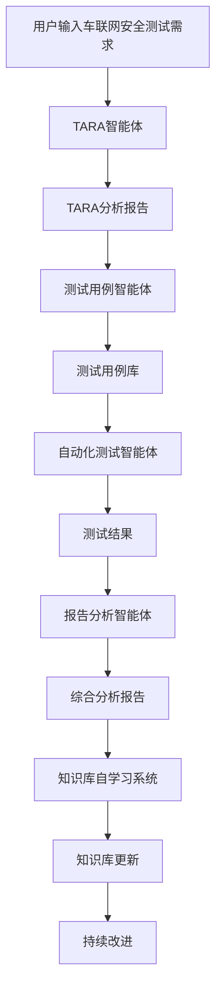

# 车联网安全测试生命周期 - 多智能体协作工作流程

## 1. 整体工作流程概览



## 2. 详细工作流程

### 2.1 阶段1：TARA分析阶段

**智能体：** TARA Agent  
**输入：** 用户需求、法规要求、车辆系统信息  
**输出：** TARA分析报告、风险评估、目标需求

```
步骤1：需求理解和解析
├── 解析用户输入的车联网安全测试需求
├── 识别适用的法规强标（如ISO 21434、UN R155等）
└── 分析车辆系统架构和组件

步骤2：威胁识别和分析
├── 基于STRIDE模型进行威胁识别
├── 分析攻击向量和攻击面
└── 评估威胁的可能性和影响

步骤3：漏洞分析
├── 识别系统中的潜在安全漏洞
├── 分析漏洞的严重程度
└── 评估漏洞被利用的可能性

步骤4：风险评估
├── 计算风险等级 (Risk = Impact × Likelihood)
├── 生成风险评估矩阵
└── 优先级排序

步骤5：缓解措施规划
├── 为高风险项制定缓解措施
├── 提供技术和管理建议
└── 制定实施计划

步骤6：合规检查
├── 对照法规要求进行合规性检查
├── 生成合规性报告
└── 提出改进建议

输出成果：
├── TARA分析报告
├── 风险评估矩阵
├── 缓解措施清单
├── 合规性检查结果
└── 测试目标和需求
```

### 2.2 阶段2：测试用例生成阶段

**智能体：** Test Case Agent  
**输入：** TARA分析报告、风险评估结果  
**输出：** 确认测试方案、验证测试方案、测试用例库

```
步骤1：分析TARA结果
├── 解析TARA分析报告
├── 提取关键风险项和威胁
└── 确定测试重点和优先级

步骤2：确认测试方案生成
├── 基于识别的威胁生成确认测试用例
├── 验证缓解措施的有效性
└── 确保测试覆盖所有高风险项

步骤3：验证测试方案生成
├── 生成功能性验证测试用例
├── 生成性能和压力测试用例
└── 生成边界条件测试用例

步骤4：测试用例优化
├── 去除重复和冗余的测试用例
├── 优化测试执行顺序
└── 平衡测试覆盖率和执行效率

步骤5：测试矩阵生成
├── 生成测试覆盖率矩阵
├── 建立测试用例与风险项的映射关系
└── 生成测试执行计划

输出成果：
├── 确认测试用例库
├── 验证测试用例库
├── 测试覆盖率矩阵
├── 测试执行计划
└── 测试环境要求
```

### 2.3 阶段3：自动化测试执行阶段

**智能体：** Automation Test Agent  
**输入：** 测试用例库、测试执行计划  
**输出：** 测试结果、执行日志、初步分析

```
步骤1：测试环境准备
├── 解析测试环境要求
├── 配置测试环境和工具
└── 验证环境就绪状态

步骤2：测试插件生成
├── 基于测试用例自动生成测试脚本
├── 生成数据驱动的测试插件
└── 集成必要的测试工具和框架

步骤3：自动化测试执行
├── 按照测试计划执行测试用例
├── 实时监控测试进度和状态
└── 自动收集测试结果和日志

步骤4：异常处理和重试
├── 检测测试执行中的异常
├── 自动重试失败的测试用例
└── 记录和分析执行问题

步骤5：结果收集和预处理
├── 汇总所有测试结果
├── 生成测试执行报告
└── 进行初步的结果分析

输出成果：
├── 详细测试结果
├── 测试执行日志
├── 测试覆盖率报告
├── 失败用例分析
└── 性能和压力测试数据
```

### 2.4 阶段4：报告分析和建议阶段

**智能体：** Report Analysis Agent  
**输入：** 测试结果、执行日志、TARA分析报告  
**输出：** 综合分析报告、修复建议、风险评估更新

```
步骤1：测试结果分析
├── 分析测试通过率和失败率
├── 识别关键的安全问题
└── 评估测试覆盖度

步骤2：问题分类和优先级
├── 按照严重程度对问题进行分类
├── 结合TARA分析确定修复优先级
└── 识别系统性问题和根本原因

步骤3：修复建议生成
├── 为每个问题提供具体的修复建议
├── 提供代码级别的改进方案
└── 建议架构和设计层面的优化

步骤4：风险评估更新
├── 基于测试结果更新风险评估
├── 重新计算剩余风险
└── 评估缓解措施的有效性

步骤5：合规性验证
├── 验证测试结果是否满足法规要求
├── 生成合规性证明文档
└── 识别需要进一步验证的项目

输出成果：
├── 综合安全分析报告
├── 问题清单和修复建议
├── 更新的风险评估矩阵
├── 合规性验证报告
└── 后续改进计划
```

### 2.5 阶段5：知识库自学习阶段

**系统：** Knowledge Base Learning System  
**输入：** 项目完整数据、测试结果、分析报告  
**输出：** 更新的知识库、优化的模板、经验总结

```
步骤1：项目数据归档
├── 自动归档项目相关的所有文档
├── 整理测试用例和结果数据
└── 保存配置和环境信息

步骤2：知识提取和总结
├── 从项目数据中提取关键知识点
├── 总结成功的测试策略和方法
└── 识别常见问题和解决方案

步骤3：模板和规则更新
├── 更新TARA分析模板
├── 优化测试用例生成规则
└── 改进报告分析算法

步骤4：经验库构建
├── 构建车型特定的经验库
├── 建立问题-解决方案映射
└── 积累行业最佳实践

步骤5：知识验证和优化
├── 验证新知识的准确性和有效性
├── 优化知识检索和推荐算法
└── 持续改进学习效果

输出成果：
├── 更新的知识库
├── 优化的智能体模板
├── 项目经验总结
├── 最佳实践库
└── 持续改进建议
```

## 3. 智能体间协作机制

### 3.1 数据流转机制
```
TARA Agent Output → Test Case Agent Input
├── 风险评估结果
├── 威胁识别清单
├── 缓解措施规划
└── 合规要求

Test Case Agent Output → Automation Test Agent Input
├── 测试用例库
├── 测试执行计划
├── 环境配置要求
└── 预期结果定义

Automation Test Agent Output → Report Analysis Agent Input
├── 测试执行结果
├── 详细执行日志
├── 性能数据
└── 异常记录

All Agents Output → Knowledge Base Learning System
├── 完整项目数据
├── 经验教训总结
├── 优化建议
└── 最佳实践
```

### 3.2 状态同步机制
```
智能体状态管理：
├── 实时状态监控
├── 任务进度跟踪
├── 异常状态处理
└── 协作状态同步

通信协议：
├── WebSocket实时通信
├── 事件驱动消息传递
├── 状态变更通知
└── 错误恢复机制
```

### 3.3 质量保证机制
```
输出质量控制：
├── 智能体输出验证
├── 数据一致性检查
├── 结果合理性验证
└── 人工review接口

持续改进：
├── 智能体性能监控
├── 结果质量评估
├── 用户反馈收集
└── 模型优化迭代
```

## 4. 关键技术实现

### 4.1 智能体通用能力架构
```python
class BaseAgent:
    """所有智能体的基础类，提供通用能力"""
    def __init__(self, llm_client, tool_registry):
        self.llm_client = llm_client               # 大语言模型客户端
        self.tool_registry = tool_registry         # 工具注册表
        self.task_decomposer = TaskDecomposer()    # 任务分解器
        self.step_executor = StepExecutor()        # 步骤执行器
        self.result_aggregator = ResultAggregator() # 结果聚合器
    
    async def generate_plan(self, user_request: str) -> Plan:
        """基于大模型生成执行计划"""
        return await self.task_decomposer.decompose(user_request, self.llm_client)
    
    async def execute_plan(self, plan: Plan) -> Result:
        """执行计划并聚合结果"""
        step_results = []
        for step in plan.steps:
            step_result = await self.step_executor.execute(step, self.tool_registry)
            step_results.append(step_result)
        
        return await self.result_aggregator.aggregate(step_results)
    
    async def process(self, request: str) -> Result:
        """通用处理流程：生成计划 -> 执行计划 -> 返回结果"""
        plan = await self.generate_plan(request)
        result = await self.execute_plan(plan)
        return result

class TaraAgent(BaseAgent):
    """TARA分析智能体 - 基于通用能力的专业化实现"""
    async def analyze(self, user_request: str) -> TaraResult:
        # 使用通用能力进行TARA分析
        return await self.process(f"进行TARA分析：{user_request}")

class TestCaseAgent(BaseAgent):
    """测试用例智能体 - 基于通用能力的专业化实现"""
    async def generate(self, tara_result: TaraResult) -> TestCaseResult:
        # 使用通用能力生成测试用例
        return await self.process(f"基于TARA结果生成测试用例：{tara_result}")

class AutoTestAgent(BaseAgent):
    """自动化测试智能体 - 基于通用能力的专业化实现"""
    async def execute(self, testcase_result: TestCaseResult) -> AutoTestResult:
        # 使用通用能力执行自动化测试
        return await self.process(f"执行自动化测试：{testcase_result}")

class ReportAgent(BaseAgent):
    """报告分析智能体 - 基于通用能力的专业化实现"""
    async def analyze(self, autotest_result: AutoTestResult, tara_result: TaraResult) -> ReportResult:
        # 使用通用能力进行报告分析
        return await self.process(f"分析测试结果并生成报告：{autotest_result}, {tara_result}")
```

### 4.2 智能体协调算法
```python
class AgentCoordinator:
    def __init__(self, llm_client, tool_registry):
        # 所有智能体都基于相同的通用能力
        self.agents = {
            'tara': TaraAgent(llm_client, tool_registry),
            'testcase': TestCaseAgent(llm_client, tool_registry),
            'autotest': AutoTestAgent(llm_client, tool_registry),
            'report': ReportAgent(llm_client, tool_registry)
        }
        self.workflow_state = WorkflowState()
    
    async def execute_workflow(self, user_request):
        # 阶段1：TARA分析（含计划生成）
        tara_result = await self.agents['tara'].analyze(user_request)
        self.workflow_state.update('tara_completed', tara_result)
        
        # 阶段2：测试用例生成（含计划生成）
        testcase_result = await self.agents['testcase'].generate(tara_result)
        self.workflow_state.update('testcase_completed', testcase_result)
        
        # 阶段3：自动化测试（含计划生成）
        autotest_result = await self.agents['autotest'].execute(testcase_result)
        self.workflow_state.update('autotest_completed', autotest_result)
        
        # 阶段4：报告分析（含计划生成）
        report_result = await self.agents['report'].analyze(autotest_result, tara_result)
        self.workflow_state.update('report_completed', report_result)
        
        # 阶段5：知识学习
        await self.knowledge_system.learn_from_project(self.workflow_state)
        
        return report_result
```

### 4.3 任务分解器实现
```python
class TaskDecomposer:
    """基于大模型的智能任务分解器"""
    
    async def decompose(self, user_request: str, llm_client) -> Plan:
        """使用大模型生成详细的执行计划"""
        prompt = f"""
        请为以下请求生成详细的执行计划：
        用户请求：{user_request}
        
        请按以下格式生成计划：
        1. 分析用户需求
        2. 确定所需工具
        3. 制定执行步骤
        4. 定义预期结果
        
        每个步骤需要包含：
        - 步骤描述
        - 所需工具
        - 输入参数
        - 预期输出
        """
        
        plan_text = await llm_client.generate(prompt)
        return self.parse_plan(plan_text)
    
    def parse_plan(self, plan_text: str) -> Plan:
        """解析大模型生成的计划文本"""
        # 解析逻辑...
        return Plan(steps=parsed_steps)
```

### 4.4 实时状态监控
```python
class WorkflowMonitor:
    def __init__(self):
        self.websocket_manager = WebSocketManager()
        self.state_tracker = StateTracker()
    
    async def track_agent_progress(self, agent_name, progress_data):
        # 更新状态
        self.state_tracker.update(agent_name, progress_data)
        
        # 实时推送给前端
        await self.websocket_manager.broadcast({
            'type': 'agent_progress',
            'agent': agent_name,
            'progress': progress_data,
            'timestamp': datetime.now()
        })
```

## 5. 性能指标和监控

### 5.1 关键性能指标 (KPIs)
```
测试效率指标：
├── TARA分析完成时间
├── 测试用例生成速度
├── 自动化测试执行时间
└── 报告生成时间

质量指标：
├── 测试覆盖率
├── 问题检出率
├── 误报率
└── 合规通过率

智能体协作指标：
├── 数据传递成功率
├── 状态同步延迟
├── 异常恢复时间
└── 整体流程成功率
```

### 5.2 监控和告警
```
实时监控：
├── 智能体运行状态
├── 资源使用情况
├── 任务执行进度
└── 系统性能指标

自动告警：
├── 智能体异常告警
├── 任务执行失败告警
├── 资源不足告警
└── 质量异常告警
```

这个多智能体协作的车联网安全测试生命周期管理平台，通过专业化的智能体分工协作，实现了从TARA分析到知识学习的完整闭环，为车企提供了全面的安全测试解决方案。 